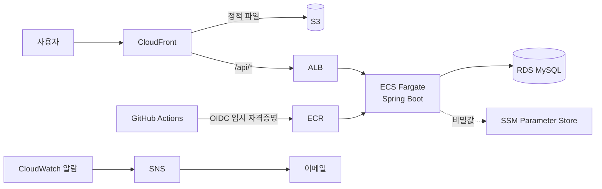

# KBO 야구팀 추천 서비스

야구를 처음 보는 사람이 8개 질문에 답하면, 성향에 맞는 KBO 팀을 추천해주는 서비스입니다.
혼자 기획하고 개발했고, Railway에서 돌리던 서비스를 Terraform으로 AWS에 옮겨 운영했습니다.

- 포트폴리오: https://app.notion.com/p/39bbf3e79e2b819db7a3cad3428e2c74
- 배포 절차와 트러블슈팅 기록: [docs/aws/07-deploy-runbook.md](docs/aws/07-deploy-runbook.md)

## 아키텍처



| 구분 | 내용 |
|---|---|
| 네트워크 | VPC, 서브넷 4개(2 AZ), IGW, 라우팅 테이블 |
| 접근 통제 | 보안그룹 3단계 (ALB → ECS → RDS), IP 대신 보안그룹끼리 참조 |
| 실행 | ECR, ECS Fargate, ALB(헬스체크 `/actuator/health`) |
| 데이터 | RDS MySQL (프라이빗 서브넷), Flyway로 스키마 관리 |
| 프론트 | S3 + CloudFront(OAC), `/api/*`는 CloudFront가 ALB로 넘김 |
| 비밀값 | SSM Parameter Store (DB 비밀번호, JWT 키) |
| 배포 | GitHub Actions + OIDC, 이미지 태그는 커밋 SHA |
| 모니터링 | CloudWatch 알람 4종 → SNS → 이메일 |
| IaC | Terraform, state는 S3에 따로 저장 |

## 이렇게 구성한 이유

**NAT Gateway를 만들지 않았습니다**
원래는 Fargate를 프라이빗 서브넷에 두고 NAT Gateway로 밖에 나가는 게 맞습니다. 그런데 NAT Gateway가 월 4만 원대로 이 구성에서 제일 비싼 리소스였습니다. 그래서 Fargate를 퍼블릭 서브넷에 두고, 보안그룹으로 ALB에서 오는 요청만 받게 막았습니다. 실제 서비스라면 프라이빗 서브넷과 NAT 또는 VPC Endpoint로 가야 한다고 생각합니다.

**보안그룹은 IP가 아니라 서로를 참조합니다**
RDS는 ECS 보안그룹에서 온 요청만, ECS는 ALB 보안그룹에서 온 요청만 받습니다. 애플리케이션을 거치지 않고는 DB에 닿을 수 없습니다.

**배포에 액세스 키를 쓰지 않습니다**
GitHub Actions가 OIDC로 AWS 역할을 받아 배포합니다. 저장소에 저장된 키가 없어서 샐 키도 없습니다. 신뢰 정책은 `main` 브랜치로만 제한했습니다.

**Terraform과 CD가 맡는 부분을 나눴습니다**
태스크 정의의 구조(환경변수, CPU, 메모리)는 Terraform이, 이미지 태그는 CD가 바꿉니다. ECS 서비스에 `ignore_changes`를 걸어서 `terraform apply`가 배포된 이미지를 되돌리지 않게 했습니다.

**알람은 적게 걸었습니다**
"울리면 지금 뭔가 해야 하는가"를 기준으로 4개만 걸었습니다. `set-alarm-state`로 알람을 강제로 울려서 장애 메일과 복구 메일이 둘 다 오는지 확인했습니다.

| 알람 | 지표 | 성격 |
|---|---|---|
| 5xx 에러 | `HTTPCode_Target_5XX_Count` | 지금 사용자가 에러를 겪는 중 |
| 비정상 타깃 | `UnHealthyHostCount` | 컨테이너 헬스체크 실패 |
| RDS 저장공간 | `FreeStorageSpace` | 디스크가 차기 전에 알림 |
| ECS 메모리 | `MemoryUtilization` | 메모리 부족으로 죽기 전에 알림 |

**쓸 때만 띄웁니다**
ALB, Fargate, RDS만 합쳐도 시간당 약 100원이라, 24시간 띄우면 월 7만 원 정도 나옵니다. 작업할 때 `apply`하고 끝나면 `destroy`합니다. Terraform state는 destroy 대상이 아닌 별도 S3 버킷에 둬서 인프라를 지워도 기록은 남게 했습니다.

## 겪었던 문제

**로그가 하나도 없는데 ECS 태스크가 계속 재시작됨**
로그가 비어 있다는 건 컨테이너가 아예 못 떴다는 뜻이라, 앱이 아니라 그 전 단계(이미지 pull, 시크릿 주입, 네트워크)를 봤습니다. zsh가 `$ECR_URL:latest`의 `:l`을 소문자 변환으로 해석해서 이미지 이름이 `...backendatest`로 바뀌어 있었습니다. 지금은 항상 `"${ECR_URL}:latest"`처럼 중괄호로 감쌉니다.

**M칩 맥에서 만든 이미지가 ECS에서 안 뜸**
쓰던 베이스 이미지가 arm64를 지원하지 않았습니다. 멀티아키텍처 이미지로 바꾸고, 빌드할 때 `--platform linux/amd64`를 지정했습니다.

**서버 2대에서 스케줄러가 두 번 실행됨**
`docker-compose.scale.yml`로 서버를 2대 띄워보니 데이터 갱신 스케줄러가 12ms 차이로 둘 다 돌았습니다. ShedLock으로 DB 락을 걸어 한 대만 실행되게 했습니다.

나머지(state 잠금, destroy 실패 등)는 [런북](docs/aws/07-deploy-runbook.md)에 정리했습니다.

## 서비스 기능

- 8문항 성향 설문으로 10개 팀 중 Top 3 추천, 팬 성향 프로필
- AI 입문 코치 채팅 (Groq → Claude → Gemini 순서로, 하나가 실패하면 다음 API로 넘어감)
- KBO 순위와 경기 결과 수집 (30분마다 갱신, 수집 실패 시 DB에 저장된 데이터로 응답)
- 회원가입과 로그인 (Spring Security + JWT)

## 기술 스택

| 구분 | 사용 기술 |
|---|---|
| Backend | Java 17, Spring Boot 3, Spring Security, JPA, Flyway, ShedLock |
| Frontend | Vue 3, Pinia, Vite |
| DB | MySQL |
| Infra | AWS (VPC, ECS Fargate, ALB, RDS, ECR, S3, CloudFront, SSM, CloudWatch, SNS), Terraform |
| CI/CD | GitHub Actions, Docker |

## 폴더 구조

```
backend/   Spring Boot API
frontend/  Vue 3
infra/     Terraform
docs/aws/  AWS 이관 과정 문서 (아키텍처, 네트워크 개념, 배포 런북)
.github/   CI (빌드, 테스트) / CD (ECS 배포)
```

## 로컬 실행

```bash
cp .env.example .env
docker-compose up --build
# http://localhost:3000
```
